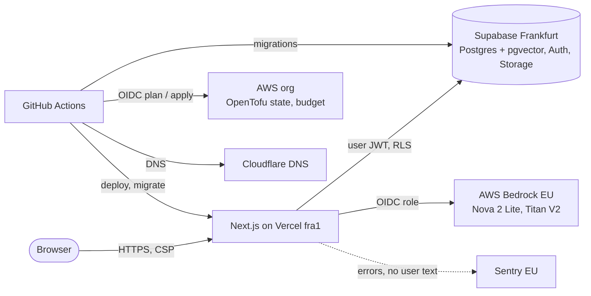
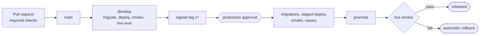

# nblm-clone

[](https://github.com/PascalNehlsen/nblm-clone/actions/workflows/ci.yml)
[](https://github.com/PascalNehlsen/nblm-clone/actions/workflows/security-scans.yml)
[](https://github.com/PascalNehlsen/nblm-clone/actions/workflows/drift.yml)

A NotebookLM clone: upload sources, ask questions, get answers that cite the exact passage.

> [!IMPORTANT]
> The app is the demo. The point is the platform around it: infrastructure as code, release gates that roll back by themselves, answer quality that is measured, data isolation proven with real tokens, and AI agents that cannot open the gates themselves.

**Live:** [app.sec-nblm.dev](https://app.sec-nblm.dev) (production) · [develop.sec-nblm.dev](https://develop.sec-nblm.dev) (develop, deployed from `main`)

> [!TIP]
> "Demo starten" on the login page gives you an anonymous account with a copy of a demo notebook, no sign-up. It is deleted after 24 hours.

## Contents

- [Highlights](#highlights)
- [Architecture](#architecture)
- [Prerequisites](#prerequisites)
- [Quick start](#quick-start)
- [Configuration](#configuration)
- [Tests](#tests)
- [Delivery and operations](#delivery-and-operations)
- [Security](#security)
- [How AI agents are used](#how-ai-agents-are-used)
- [Repository layout](#repository-layout)
- [Documentation](#documentation)
- [Status](#status)

## Highlights

| Area | What is in place |
|---|---|
| Answers | Retrieval per notebook (pgvector). Citations are checked on the server: the passage must have been retrieved for this question and the quote must be in it. The model says when the sources have no answer |
| Data isolation | Row level security on every table, membership roles owner, editor and viewer. 494 RLS tests sign in with real JWTs; pgTAP catalog checks block bypasses |
| AI safety | Sources are data, never instructions (delimited blocks with a per-turn nonce). The model gets no tools. A live eval with prompt-injection cases is a hard gate on develop |
| Cost | A budget check before every model call (per user, tighter for demo users, global), a kill switch, a monthly AWS budget alarm |
| Release | Tag, approval, migrations first, staged deploy, smoke test and canary question, promote, live smoke, automatic rollback. Proven in a [game day](docs/postmortems/2026-10-20-game-day.md): rolled back in 43 s |
| Infrastructure | OpenTofu: AWS organization with an EU region guard, OIDC instead of keys, encrypted state, Cloudflare DNS with DNSSEC. Plan in the PR, apply only in CI after approval, nightly drift check |
| Supply chain | Every action pinned to a SHA, secret scan, workflow audit (zizmor), dependency review, CodeQL, IaC scan (trivy) |
| Observability | Sentry in the EU with technical data only (no user text), an operator ops page with cost, latency, failures and the eval score |

## Architecture



| Area | Choice |
|---|---|
| App | Next.js (App Router, TypeScript strict) on Vercel, region `fra1`. UI in German |
| Data | Supabase in Frankfurt: Postgres with pgvector, Auth (GitHub OAuth, anonymous demo behind Turnstile), private Storage, pg_cron |
| AI | AWS Bedrock in the EU through an EU inference profile, reached from Vercel via OIDC; model ids only from server env |
| Infrastructure | OpenTofu stacks `bootstrap`, `aws`, `cloudflare`. GitHub rulesets and environments are set by hand and documented (as code in v1.1) |
| Delivery | GitHub Actions: `develop` from `main`, production from a signed release tag with a required reviewer |

## Prerequisites

| Tool | Version | Needed for |
|---|---|---|
| Node.js | 24.x (`engines` in `package.json`) | everything |
| pnpm | 12.9.0 (`packageManager`, via Corepack) | everything |
| Docker | recent | the local Supabase stack (`test:db`, `test:rls`, `test:e2e`) |
| Supabase CLI | pinned dev dependency, nothing to install | local database |
| Playwright Chromium | `pnpm exec playwright install chromium` once | end-to-end tests |
| OpenTofu | pinned, downloaded and checksummed by `scripts/tofu.sh` | `infra/` only |

> [!NOTE]
> Linux is the tested platform: `scripts/tofu.sh`, `scripts/gitleaks.sh` and `scripts/trivy.sh` download pinned, checksummed Linux binaries.

## Quick start

```bash
pnpm install
pnpm db:start                                   # local Supabase in Docker
pnpm exec supabase status                       # copy API_URL and PUBLISHABLE_KEY
cp .env.example apps/web/.env.local             # fill in the three NEXT_PUBLIC_* values
pnpm --filter web dev -H 127.0.0.1              # http://127.0.0.1:3000
```

> [!WARNING]
> Open `http://127.0.0.1:3000`, not `localhost`: the login cookie and the auth callback use `127.0.0.1`. Without the three `NEXT_PUBLIC_*` values every page answers 500.

## Configuration

Names are in [`.env.example`](.env.example). Values are never committed.

| Variable | Where | Required | Purpose |
|---|---|---|---|
| `NEXT_PUBLIC_SUPABASE_URL` | `apps/web/.env.local` | yes | Supabase API URL |
| `NEXT_PUBLIC_SUPABASE_PUBLISHABLE_KEY` | `apps/web/.env.local` | yes | publishable key; the app refuses a secret key here |
| `NEXT_PUBLIC_SITE_URL` | `apps/web/.env.local` | yes | own origin, for redirects and the CSP |
| `SUPABASE_SECRET_KEY` | server only | for model calls | budget checks and admin paths; without it every model call fails closed |
| `BEDROCK_CHAT_MODEL_ID`, `BEDROCK_EMBEDDING_MODEL_ID` | server only | for model calls | model ids; all model config stays on the server |
| `SUPABASE_AUTH_EXTERNAL_GITHUB_CLIENT_ID`, `..._SECRET` | your shell | for GitHub login | local OAuth app, callback `http://127.0.0.1:54321/auth/v1/callback` |
| `NEXT_PUBLIC_SENTRY_DSN` | Vercel Production | no | error tracking; the SDK stays off unless the DSN is a Sentry EU host |

> [!CAUTION]
> Never put the Supabase secret key in a `NEXT_PUBLIC_*` variable or in Vercel Preview. `GAME_DAY_FAULT` is for the [game day](docs/runbooks/game-day.md) only and must not be set otherwise.

## Tests

```bash
pnpm lint && pnpm typecheck && pnpm test && pnpm build   # what the app CI job runs

pnpm test:db      # pgTAP: catalog checks, each with a negative self-test
pnpm test:rls     # RLS matrix: owner, editor, viewer, stranger, anon with real JWTs, never the service role
pnpm test:e2e     # Playwright against a production build and the local stack
node --test 'tests/ci/*.test.mjs'   # workflow, smoke, eval and guard tests
```

Infrastructure tests (no cloud access needed):

```bash
scripts/tofu.sh -chdir=infra/aws init -backend=false -test-directory=../../tests/infra/aws
scripts/tofu.sh -chdir=infra/aws test -test-directory=../../tests/infra/aws
scripts/trivy.sh config --skip-check-update --severity HIGH,CRITICAL --exit-code 1 --ignorefile .trivyignore.yaml infra
```

> [!NOTE]
> Database tests need Docker. Turn off the Supabase CLI telemetry with `export SUPABASE_TELEMETRY_DISABLED=1 DO_NOT_TRACK=1 SUPABASE_NO_UPDATE_NOTIFIER=1`.

## Delivery and operations



| What | Where |
|---|---|
| Release a version | [runbooks/release.md](docs/runbooks/release.md) |
| Develop deploys | [runbooks/develop-deploy.md](docs/runbooks/develop-deploy.md) |
| Infra plan and apply | [runbooks/infra-apply.md](docs/runbooks/infra-apply.md), [runbooks/bootstrap.md](docs/runbooks/bootstrap.md) |
| Stop all model calls | [runbooks/kill-switch.md](docs/runbooks/kill-switch.md) |
| Operator access to `/ops` | [runbooks/ops-access.md](docs/runbooks/ops-access.md) |
| Rehearse the rollback | [runbooks/game-day.md](docs/runbooks/game-day.md) |

> [!IMPORTANT]
> Apply, deploy and migrations run only in CI. Production needs a human approval, and no agent can merge, tag or approve.

## Security

- Threat model mapped to the OWASP Top 10 for LLM applications: [`SECURITY.md`](SECURITY.md)
- What personal data is stored where, and for how long: [`docs/privacy.md`](docs/privacy.md)
- Enforced Content-Security-Policy (`img-src 'self'`, no framing), checked by the release smoke ([ADR 0020](docs/adr/0020-content-security-policy.md))
- URL import behind an SSRF guard ([ADR 0008](docs/adr/0008-ssrf-guard.md)); uploads checked by magic bytes
- Users delete their own account, including embeddings and files ([ADR 0021](docs/adr/0021-account-deletion.md))

## How AI agents are used

Claude Code writes most of the code in roles (planner, test-author, builder, reviewer); Codex reviews PRs (run by hand until the CI job exists, v1.1). Tests come first for every high-risk change, and every PR records what review or CI caught in its gate log.

> [!NOTE]
> The repository separates what is enforced (rulesets, environments, OIDC trust, the agent sandbox) from what is only an instruction. See the table "Where the hard limits are" in [`AGENTS.md`](AGENTS.md) and [`docs/ai-workflow.md`](docs/ai-workflow.md).

## Repository layout

```text
apps/web/            Next.js app (App Router); server-only code in lib/server/
supabase/            migrations, config, pgTAP tests
infra/               OpenTofu stacks: bootstrap, aws, cloudflare
tests/               unit, rls, e2e, eval, ci (workflow tests), infra (tofu tests)
scripts/             smoke, canary, eval, plan guard, pinned tool wrappers
.github/workflows/   ci, develop, release, infra, drift, security scans, guardrails
docs/                roadmap, ADRs, runbooks, postmortems, privacy
```

## Documentation

- [`docs/roadmap.md`](docs/roadmap.md): what is built, what comes next, what is deliberately not built
- [`docs/adr/`](docs/adr/): 25 architecture decisions, one screen each
- [`docs/runbooks/`](docs/runbooks/): operations, each with a "last rehearsed" date
- [`docs/postmortems/`](docs/postmortems/): game day and incidents
- [`docs/ai-workflow.md`](docs/ai-workflow.md): sandbox, agent roles, gates
- [`AGENTS.md`](AGENTS.md): rules for agents and humans

## Status

v1 is live. Next (v1.1): a hardened EC2 worker for audio overviews, a restore drill, GitHub rulesets as code, the Codex review as a CI job. Details in [`docs/roadmap.md`](docs/roadmap.md).
